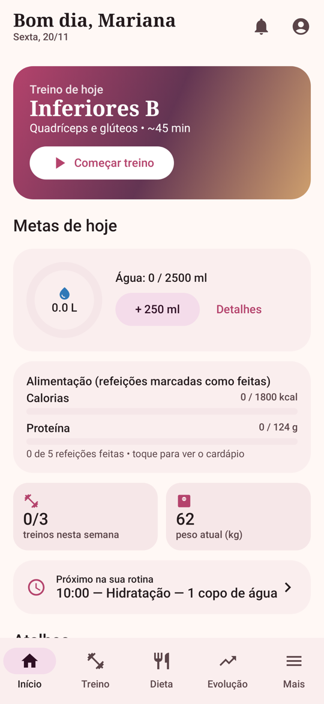
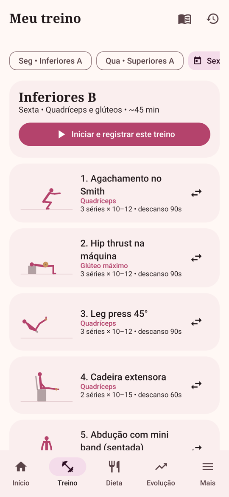
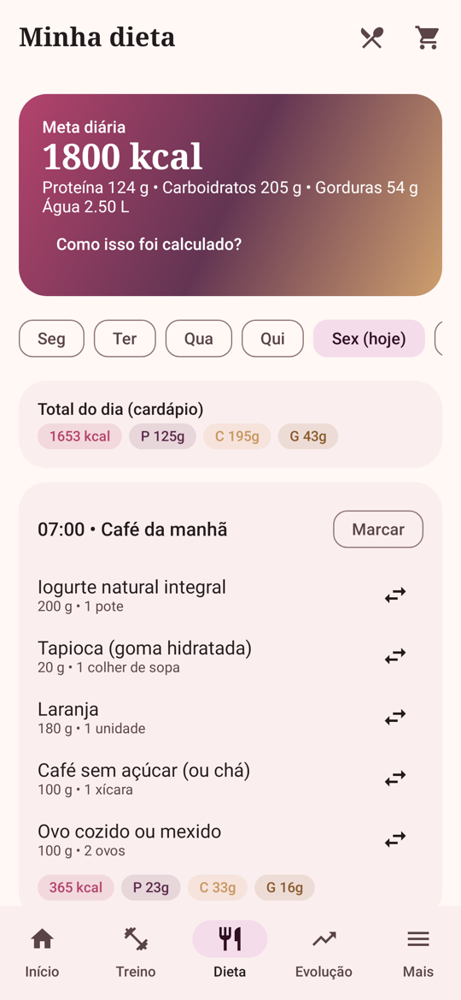
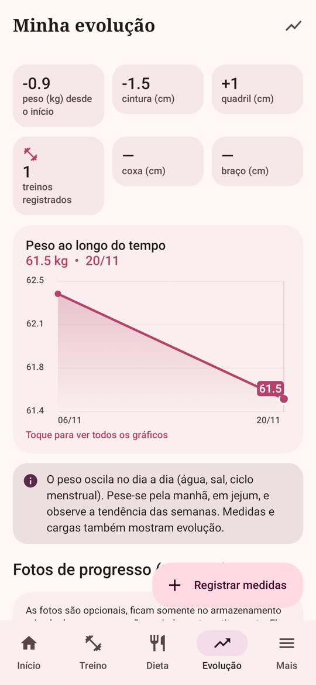

# Áurea — Treino, Nutrição e Evolução (Android)

**Áurea** é um aplicativo Android nativo (Kotlin + Jetpack Compose) que funciona como treinador pessoal e guia de alimentação para o público feminino: monta a ficha de treino, calcula e organiza a dieta, cria a rotina diária com lembretes, acompanha a evolução e ajusta o plano com check-ins periódicos.

> O nome vem da **proporção áurea** — a ideia de equilíbrio entre cintura, quadril e pernas que inspirou a "Meta Áurea" (referência estética do app).

- **APK pronto:** [`releases/Aurea-1.1.0.apk`](releases/Aurea-1.1.0.apk) (1,8 MB, Android 7.0 ou superior)
- **Android:** APK acima. **iPhone:** versão web instalável em <https://aurea-treino.netlify.app> (veja a seção "Versão para iPhone").
- O app é **educativo** e não substitui médico(a), nutricionista ou educador(a) físico(a).

<p>
   
</p>


## App nativo para iPhone (arquivo .ipa)

Além da versão web, existe um **app nativo de iPhone** (`AureaFit/ios-app`), gerado automaticamente num **Mac do GitHub** a cada atualização (workflow `.github/workflows/ios.yml`). Ele usa o mesmo app e as mesmas regras, e tem **lembretes locais do próprio iOS** — funcionam sem internet e sem servidor.

**Baixar:** página **Releases** do repositório → `ios-latest` → `Aurea-1.1.0.ipa` (https://github.com/MikaelSoaresSilva/hydra-source/releases/tag/ios-latest).

**Por que precisa de um passo extra:** a Apple só deixa instalar no iPhone apps **assinados** com uma conta Apple. O `.ipa` é gerado sem assinatura; a assinatura é feita na hora de instalar:

**Opção A — grátis, com um computador (Windows ou Mac) e o Apple ID dela:**
1. Instale o **Sideloadly** (sideloadly.io) no computador (no Windows, instale também o iTunes e o iCloud do site da Apple).
2. Conecte o iPhone por cabo, abra o Sideloadly, arraste o `Aurea-1.1.0.ipa`, digite o **Apple ID** e clique em **Start**.
3. No iPhone: **Ajustes → Geral → VPN e Gerenciamento de Dispositivos** → toque no Apple ID → **Confiar**. No iOS 16+, ative também **Ajustes → Privacidade e Segurança → Modo de Desenvolvedor** (o iPhone reinicia).
4. Com Apple ID gratuito, a Apple exige **reinstalar a cada 7 dias** (os dados ficam). O **AltStore** (altstore.io) faz essa renovação automaticamente pelo Wi-Fi.

**Opção B — sem renovações, com conta de desenvolvedor Apple (US$ 99/ano):** com a conta, o app pode ser distribuído pelo **TestFlight** (convite por e-mail, instala como app normal) ou publicado na App Store. É preciso configurar os certificados da conta no workflow (podemos fazer isso quando a conta existir).

**Sem nada disso:** a versão web (abaixo) funciona no iPhone hoje, com as mesmas telas, offline e com lembretes.

## Versão para iPhone (web app instalável)

Arquivos **APK só instalam em Android** — o iPhone recusa esse formato por regra da Apple. Para iPhone existe a versão **web app (PWA)**, com as mesmas telas e **exatamente as mesmas regras** de treino, dieta, segurança e ajustes: o código Kotlin da pasta `domain/` é compilado para JavaScript (módulo `web/`), então os cálculos são idênticos aos do Android.

**Como instalar no iPhone:**
1. Abra **<https://aurea-treino.netlify.app>** no **Safari** (precisa ser o Safari).
2. Toque em **Compartilhar** (quadrado com seta ↑) → **Adicionar à Tela de Início** → **Adicionar**.
3. Abra o Áurea pelo ícone criado. Ele funciona em tela cheia e, depois da primeira abertura, **sem internet**.

**O que foi feito para contornar as limitações do iPhone:**
- **Lembretes com o app fechado (notificações push):** o iPhone (iOS 16.4+) só aceita notificações de web apps **instalados na Tela de Início** e enviadas por um servidor. O Áurea tem um pequeno servidor no Netlify (`web/server/netlify/functions`): a usuária toca em **Ativar lembretes** (Painel, Calendário ou Configurações), recebe uma notificação de teste na hora e, a partir daí, recebe refeições, treino, água, pausa, sono e check-in no horário da rotina — com o app fechado. Ao editar horários no Calendário, o servidor é atualizado sozinho.
  - **Privacidade:** o servidor recebe **somente** os horários e textos dos lembretes e o fuso horário. Peso, medidas, fotos, dieta, nome e e-mail **nunca** saem do iPhone. "Desativar lembretes" (ou "Excluir conta") apaga o registro do servidor.
  - As chaves de segurança do push são geradas e guardadas pelo próprio servidor (Netlify Blobs); a chave privada nunca é copiada para lugar nenhum.
- **Calendário (opcional):** "Adicionar rotina ao Calendário" abre a rotina direto no app Calendário do iPhone (tocar em **Adicionar Todos**), com alertas que funcionam até sem internet.
- **Funciona offline** depois da primeira abertura.
- **Dados protegidos:** o app pede armazenamento persistente e mostra um lembrete mensal de backup (Configurações → Exportar, para iCloud Drive/Arquivos). Os dados do iPhone e do Android não se misturam.
- **Selo do Netlify:** no plano gratuito ele não pode ser removido; o layout reserva o canto inferior para que o selo nunca cubra botões.
- Não existe na versão web: bloqueio de capturas de tela.

**Atualizar a versão web:** `./gradlew :web:assemblePwa` gera `web/server/public`; publique a pasta **`web/server`** no Netlify (contém o site e as funções). O app atualiza sozinho na próxima abertura com internet.

**Testes da versão web:** percurso completo automatizado em navegador simulando iPhone 13, nos motores **Chromium e WebKit (o do Safari)**: cadastro, questionário, treino, troca de alimento, água, calendário (.ics com 17 lembretes), medidas, gráficos, check-in, troca de objetivo, backup, dados mantidos após recarregar e funcionamento **offline com o servidor desligado** — sem nenhum erro. Servidor de lembretes testado de ponta a ponta (chaves no servidor, teste imediato, envio no minuto certo sem repetição, fuso horário, dias da semana, remoção de aparelhos que revogaram permissão) e ativação/sincronização/desativação testadas na interface. O site publicado também foi verificado nos dois motores.

---

## 1. Como instalar (passo a passo, sem conhecimento técnico)

1. No celular Android, abra este repositório no navegador e toque em `releases/Aurea-1.1.0.apk` → **Download** (ou receba o arquivo pelo WhatsApp/Drive/cabo USB).
2. Toque no arquivo baixado. O Android pode avisar *"Por segurança, seu telefone não tem permissão para instalar apps desta fonte"* → toque em **Configurações** → ative **Permitir desta fonte** → volte.
3. Toque em **Instalar** e depois em **Abrir**.
4. Crie sua conta (nome, e-mail e senha — tudo fica salvo só no celular), responda o questionário (≈5 min) e pronto.
5. Quando o app pedir, **permita notificações** para receber os lembretes.

Se o Play Protect mostrar um aviso, é porque o app não vem da Play Store. Toque em **Mais detalhes → Instalar mesmo assim**.

## 2. Como atualizar para versões futuras

Para o Android aceitar a atualização **sem apagar os dados**, a nova versão precisa:
1. Ter o **mesmo nome de pacote** (`com.aurea.fit`) — já está configurado;
2. Ter `versionCode` **maior** (em `app/build.gradle.kts`, ex.: `versionCode = 2`, `versionName = "1.1.0"`);
3. Ser assinada com a **mesma chave** (`aurea-release.jks`).

Depois é só instalar o novo APK por cima do antigo. Recomenda-se fazer um **backup** (Configurações → Exportar meus dados) antes.

### Chave de assinatura (importante)
O repositório é público, então a chave **não está no Git**. Ela foi entregue separadamente (arquivos `aurea-release.jks` e `keystore.properties`). Para gerar um APK de atualização:

```bash
# na pasta AureaFit/
mkdir -p keystore && cp /caminho/aurea-release.jks keystore/
cp /caminho/keystore.properties .
./gradlew assembleRelease
# resultado: app/build/outputs/apk/release/app-release.apk
```
**Guarde a chave em local seguro (ex.: Google Drive pessoal).** Se ela for perdida, novas versões só poderão ser instaladas desinstalando a anterior (o que apaga os dados — por isso existe o backup). Sem `keystore.properties`, o build de release usa a chave de debug (útil para testes).

## 3. Como compilar a partir do código

Requisitos: JDK 17+, Android SDK (plataforma 35, build-tools 35). Abra a pasta `AureaFit` no Android Studio, ou:
```bash
./gradlew assembleDebug          # APK de testes
./gradlew testDebugUnitTest      # executa os 40 testes automatizados
./gradlew assembleRelease        # APK final otimizado (R8)
```

---

## 4. Recursos implementados

| # | Tela / recurso | O que faz |
|---|---|---|
| 1 | Abertura | Logotipo animado; decide se vai para cadastro, login, questionário ou painel. |
| 2 | Cadastro e login | Conta local; senha protegida com hash PBKDF2 + sal aleatório; troca de senha; sair. |
| 3 | Questionário inicial | 12 etapas, uma por vez, com barra de progresso e validação: dados pessoais, objetivo, experiência, objetivo corporal (múltipla escolha), estrutura de treino (dias, dias disponíveis, tempo, local, equipamentos), exercícios preferidos/excluídos, dores/limitações, alimentação (refeições, orçamento, cozinhar, tempo de preparo, econômica, alimentos brasileiros), preferências (restrição, alergias, alimentos habituais e rejeitados), rotina (acordar, dormir, treino, trabalho/estudo, atividade, sono), saúde (opcional) e avaliação física. |
| 4 | Seleção do objetivo | Emagrecimento, ganho de massa muscular, recomposição, manutenção e ganho de peso — com prévia das novas metas antes de aplicar. |
| 5 | Avaliação física | IMC, cintura, relação cintura/quadril e cintura/altura (com aviso de limitações), orientação de como medir, recálculo do plano. |
| 6 | Painel principal | Treino do dia, metas de água, calorias e proteína (pelas refeições marcadas), treinos da semana, peso atual, próximo compromisso, atalhos, alerta de check-in e avisos de segurança. |
| 7 | Ficha de treinamento | Divisão semanal individual, séries, repetições, descanso, troca de exercício por alternativa compatível, cardio, orientações e histórico. |
| — | Registro do treino | Carga e repetições por série, ✓ por série com cronômetro de descanso, esforço percebido (1–10), boa execução, dor; **sugestão automática de progressão**. |
| 8 | Biblioteca de exercícios | 73 exercícios, busca, filtro por músculo e "dá para fazer em casa". |
| — | Detalhe do exercício | **Animação demonstrativa** (desenhada pelo app, funciona offline), músculos, passo a passo, dicas de técnica, cuidados, alternativas sem o equipamento, link para vídeos e gráfico de evolução de carga. |
| 9 | Dieta personalizada | Metas calculadas (com explicação), cardápio de 7 dias, café, lanches, almoço, pré/pós-treino, jantar e ceia conforme o número de refeições; gramas + medidas caseiras + calorias e macros; marcar refeição feita; substituição de qualquer alimento (no dia ou em todos os dias); custo mensal estimado. |
| 10 | Receitas e substituições | 12 receitas simples (econômicas, sem fogão, para dias corridos, vegana) e tabela de equivalências. |
| 11 | Lista de compras | Total semanal convertido para peso cru, custo semanal/mensal, marcar itens, compartilhar (WhatsApp etc.). |
| 12 | Controle de água | Anel de progresso, botões rápidos, quantidade livre, meta automática (35 ml/kg) ou manual, tamanho do copo, gráfico de 7 dias. |
| 13 | Calendário | Mês com dias de treino e treinos concluídos; rotina do dia (acordar, refeições, treino, água, pausa, sono, check-in); editar horário/texto/dias, ligar/desligar, criar e excluir lembretes. |
| 14 | Minha evolução | Peso, cintura, quadril, coxa, braço; variação desde o início; fotos de progresso **privadas** (opcionais). |
| 15 | Gráficos | Medidas, relação cintura/quadril, frequência semanal de treinos, carga e volume por exercício — gráficos interativos (toque/arraste). |
| 16 | Configurações | Tema claro/escuro/automático, lembretes, notificação de teste, ocultar calorias, bloquear capturas de tela, backup/exportação, restauração, senha, sair, excluir conta. |
| 17 | Perfil | Resumo das respostas e edição completa (refaz o questionário com as respostas atuais). |
| 18 | Central de notificações | Histórico dos lembretes recebidos, contador de não lidas. |
| — | Check-in semanal | 9 perguntas (treinos, dificuldade, recuperação, sono, alimentação, dieta, fome, satisfação, dores) → recomendações explicadas que a usuária escolhe aplicar. |
| — | Histórico de planos | Toda alteração gera nova versão com o motivo; é possível ver e restaurar planos anteriores. |

### Como o app usa as fotos de referência
As 4 fotos enviadas foram analisadas como referência de objetivo estético — glúteos desenvolvidos e arredondados, pernas fortes (quadríceps, posteriores, panturrilhas), cintura marcada, costas definidas e abdômen firme. Isso virou a **"Meta Áurea"** (ativada por padrão, pode ser desligada no questionário), que:
- prioriza glúteo máximo e médio, pernas, costas e core na divisão de treino e dá +1 série aos músculos prioritários (para intermediárias/avançadas);
- mantém peito, ombros e braços no plano para um físico equilibrado.

As fotos **não foram incluídas no app** (são de terceiros e podem ter direitos autorais) e o app deixa claro que **não promete resultado idêntico às fotografias**: genética e estrutura são individuais, e abdômen muito definido exige gordura corporal baixa, que não é saudável/sustentável para todas.

### Regras de segurança implementadas
- Menor de 18, gestante, lactante, histórico de transtorno alimentar ou IMC < 18,5 → **sem déficit calórico** e orientação para procurar profissional.
- Condição clínica ou medicamentos → déficit limitado a 10% e aviso.
- Calorias nunca abaixo do gasto basal nem de 1.200 kcal; déficit máximo de 15–20%.
- Ajuste de calorias **só com ≥ 4 pesagens em ≥ 14 dias** (não reage a oscilações de poucos dias); perda > 1%/semana → aumenta calorias.
- Volume de treino **nunca aumenta** com sono/recuperação ruins; dor → adapta exercícios e recomenda avaliação.
- Iniciantes: no máximo 4 treinos de força/semana (os demais viram recuperação ativa).
- Opção de ocultar calorias.

### Base dos cálculos
- Gasto basal: **Mifflin-St Jeor** (1990). Fator de atividade = atividade diária + treinos.
- Proteína 1,6–2,0 g/kg (peso de referência em IMC 25 quando IMC > 27); gorduras ≈ 27% das calorias (mín. 0,7 g/kg); carboidratos completam o total.
- Água: 35 ml/kg.
- Alimentos: valores aproximados da tabela **TACO/UNICAMP**; preços são estimativas médias e variam por região.
- Progressão: dupla progressão (repetições → carga) condicionada a esforço percebido ≤ 8, boa execução, ausência de dor e boa recuperação.

---

## 5. Arquitetura

```
app/src/main/java/com/aurea/fit/
├── domain/        Regras de negócio em Kotlin puro (testáveis sem celular)
│   ├── Models.kt          perfil e enums do questionário
│   ├── Nutrition.kt       segurança + cálculo de calorias/macros/água
│   ├── ExerciseLibrary.kt 73 exercícios (execução, dicas, alternativas)
│   ├── Workout.kt         gerador de ficha + progressão de cargas
│   ├── Foods.kt           50 alimentos brasileiros
│   ├── Diet.kt            gerador de cardápio, substituições, lista de compras, receitas
│   └── Adjustments.kt     motor de ajustes do check-in
├── data/          Room (SQLite), repositório, preferências, backup .zip
├── notifications/ AlarmManager + receivers (lembretes, reagendamento após reiniciar)
└── ui/            Jetpack Compose (Material 3): tema, componentes, gráficos,
                   animações de exercícios, navegação e 18+ telas
```
- **Offline-first:** tudo funciona sem internet (só o link de vídeos usa a web).
- **Leve:** APK de 1,8 MB, sem imagens pesadas (animações vetoriais), R8 ativado, minSdk 24 (Android 7.0).
- **Injeção de dependências manual** (`AppContainer`), um `AppViewModel` com fluxos (`StateFlow`) do banco.

## 6. Dados, privacidade e backup

- Todos os dados ficam no **armazenamento privado do app** (banco `aurea.db` e pasta `photos/`). Outros apps não têm acesso.
- **Nenhum dado é enviado a servidores.** O backup automático do Android para a nuvem foi **desativado** (`allowBackup=false` + regras de exclusão) para que fotos e dados de saúde não saiam do aparelho sem autorização.
- **Backup / exportação:** Configurações → *Exportar meus dados* gera um `.zip` (`dados.json` + fotos opcionais). Você escolhe onde salvar — memória, cartão ou **Google Drive** (é o "backup com autorização": só acontece quando você manda).
- **Restaurar:** Configurações → *Restaurar backup* → escolha o `.zip` (substitui os dados atuais). Proteção contra arquivos maliciosos ("zip slip").
- **Excluir conta:** apaga banco, fotos, preferências e lembretes de forma definitiva.
- Não há servidor/banco remoto para configurar. Se no futuro quiser sincronização em nuvem, a camada `data/Repository.kt` é o ponto de integração (ex.: Firebase), sem mudar as telas.

## 7. Relatório de testes

Executados com `./gradlew testDebugUnitTest` — **40 testes, 40 aprovados**.

| Grupo | O que foi testado |
|---|---|
| Nutrição (8) | Fórmula de Mifflin, déficit moderado + piso de segurança, superávit, menor de idade, gestação/amamentação/TA, IMC baixo, condição clínica, proteína com IMC alto. |
| Treino (7) | Geração para 1–7 dias × academia/casa × 3 níveis (126 combinações) sem exercícios impossíveis nem repetidos; limitações e exclusões respeitadas; limite de iniciante; prioridade de glúteos; dias disponíveis; tempo curto × longo; dados completos dos 73 exercícios. |
| Progressão (6) | Aumento de carga, manutenção com esforço alto, técnica ruim, recuperação ruim, dor, primeira vez. |
| Dieta (7) | 5 objetivos × 3–6 refeições × 7 dias com calorias (±12%) e proteína dentro da meta; vegana + sem glúten + sem amendoim; lactose e alimentos rejeitados; pré/pós-treino; substituições equivalentes; lista de compras e custos; medidas caseiras. |
| Ajustes (6) | Não muda calorias com poucos dias; corta só com platô + adesão; perda rápida aumenta; recuperação ruim nunca aumenta volume; dor; menor nunca recebe corte. |
| Repositório (1) | Cadastro/login/senha errada, perfil→planos, registro de treino, alarmes agendados, check-in→nova versão→restaurar, substituição de alimento, **exportar backup → excluir tudo → restaurar** (incluindo foto). |
| Interface ponta a ponta (1) | Robô cria conta, responde as 12 etapas, chega ao painel, registra água, inicia e conclui treino, navega por todas as telas, registra medidas, faz check-in, troca de objetivo e verifica o histórico — com captura de cada tela. |
| Telas em outros formatos (3) | Celular pequeno (320×568 dp), modo escuro e tablet (800×1280 dp). |
| Animações (1) | Renderização das 37 animações (posição inicial e final) para conferência visual. |

Capturas em [`docs/telas/`](docs/telas/). Também verificado: APK assinado (`apksigner verify`), nome do pacote, versão e Activity principal (`aapt2 dump badging`).

**Teste do APK num Android real (emulado):** o APK final foi instalado num emulador Android 11 (x86_64, emulação por software, sem aceleração de hardware): instalação `Success`, app aberto, tela de abertura → tela de cadastro, sem nenhum erro (`FATAL`) no log. Como esse emulador é muito lento, o percurso completo das telas foi testado com Robolectric (Android simulado na JVM). Ainda vale testar num celular físico.

## 8. Problemas encontrados e corrigidos

1. **Formatação de texto quebrava o check-in** — frases com "1% do peso" eram interpretadas como código de formatação (`IllegalFormatConversionException`). Corrigido escapando `%%`.
2. **Dieta com proteína abaixo da meta** em planos de 3 refeições (porções máximas insuficientes). Corrigido com complemento automático de proteína e limites revisados.
3. **Dieta com calorias 17% acima da meta** (porções mínimas + alimentos fixos). Criado ajuste fino que reduz gorduras, carboidratos e leguminosas até ficar no alvo.
4. **Leite sem lactose/bebida de soja aparecendo para quem não precisa** — agora só aparecem com intolerância, dieta vegana ou se a pessoa já consome.
5. **Navegação fora da thread principal após login** (falha detectada pelo teste de interface) — navegação agora sempre volta para a thread de interface.
6. **Botão "Detalhes" quebrava letra por letra em telas pequenas** — layout do cartão de água refeito.
7. **Baixo contraste do cartão de destaque no modo escuro** — gradiente com cores fixas da marca.
8. **Animações**: braços atravessando o banco na mesa flexora, prancha lateral confusa e ponte com pouca elevação — poses corrigidas após inspeção visual.
9. **Tela de abertura podia travar em celulares lentos** (encontrado ao rodar o APK num emulador sem aceleração): se a animação terminasse antes do banco responder, o app não avançava. Agora a navegação espera as duas coisas, em qualquer ordem.
10. **Chave de assinatura**: o repositório é público, então a chave foi retirada do Git e passou a ser lida de um arquivo local.

## 9. Próximos passos sugeridos
- Publicar na Google Play (exige conta de desenvolvedor, política de privacidade e App Bundle `.aab`: `./gradlew bundleRelease`).
- Sincronização em nuvem opcional e criptografia do banco (SQLCipher).
- Vídeos próprios gravados para cada exercício.
